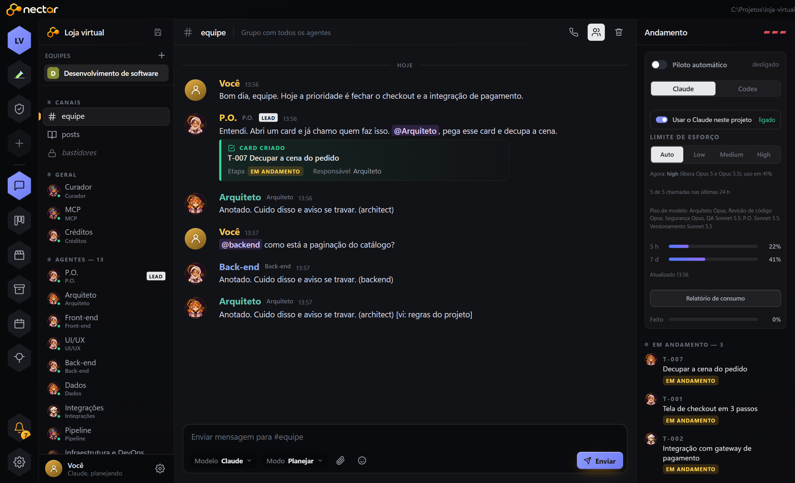
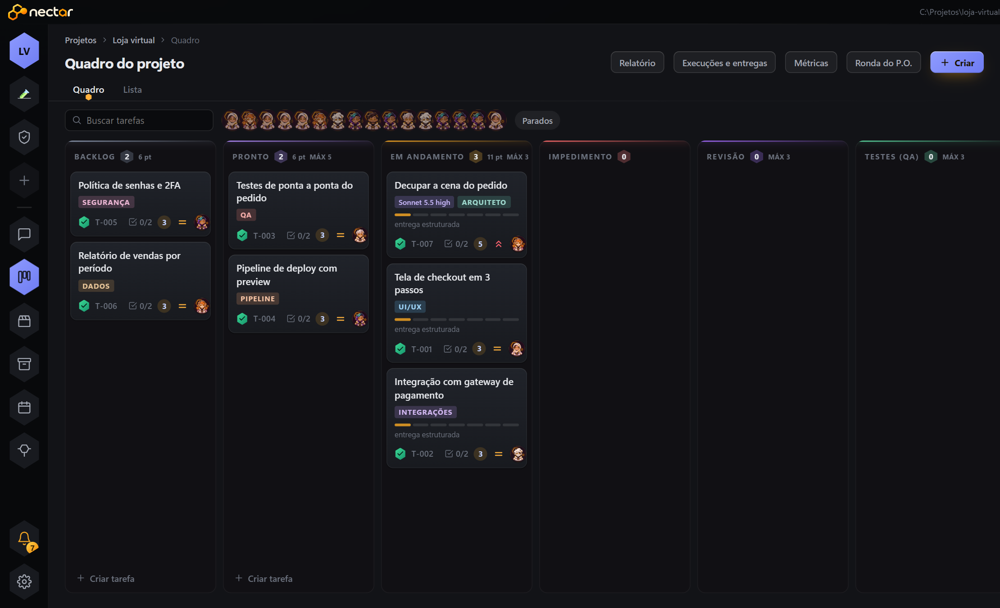
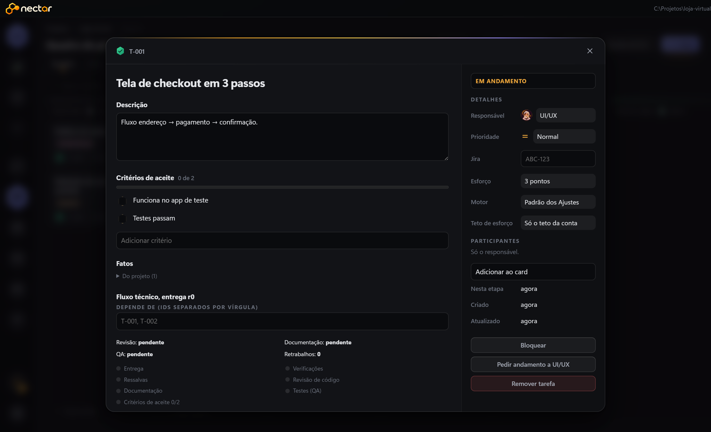
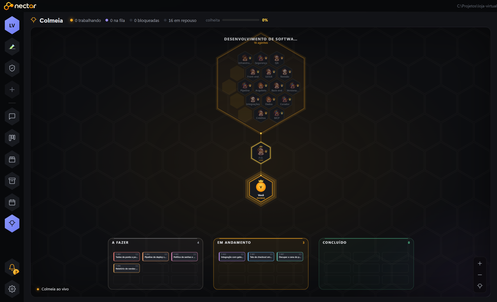
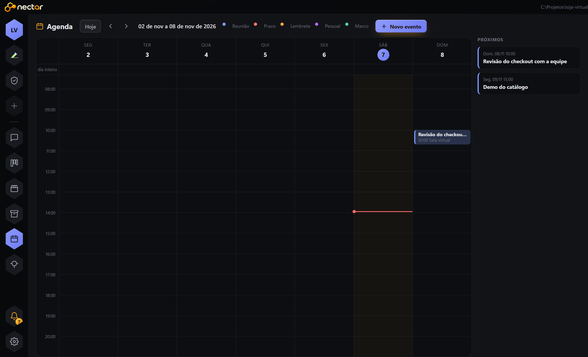

<p align="center">
  
</p>

<h1 align="center">NECTAR</h1>

<p align="center">
  <strong>Uma equipe inteira de agentes de IA trabalhando no seu projeto, do jeito que um time de verdade trabalha.</strong><br>
  Chat, quadro de tarefas, memória, agenda e uma colmeia que mostra quem está fazendo o quê.
</p>

<p align="center">
  <a href="#começar">Começar</a> ·
  <a href="#como-funciona">Como funciona</a> ·
  <a href="#equipes-prontas">Equipes prontas</a> ·
  <a href="#apoie-o-projeto">Apoie o projeto</a> ·
  <a href="#licença">Licença</a> ·
  <a href="#contato">Contato</a>
</p>

<p align="center">
  
</p>

---

## A ideia

Ferramentas de IA para código costumam ser um único assistente que faz tudo. A NECTAR parte de outro princípio: **projetos grandes precisam de papéis, combinados e um quadro à vista**.

Você descreve o que quer no chat. A liderança da equipe (uma P.O., uma Chief of Staff, uma Game Director, dependendo do template) transforma o pedido em cards, distribui para os especialistas certos, cobra critérios de aceite, passa por revisão e QA, e volta com uma entrega conferida. Tudo fica registrado: quem fez, com que evidência, quanto custou.

Os agentes rodam nos **CLIs que você já tem instalados** (Claude Code e Codex). A NECTAR não revende modelo, não guarda sua chave e não manda seu projeto para lugar nenhum: tudo roda no seu computador, com as contas e os limites que você já usa.

## O que você ganha

- **Uma equipe com papéis definidos.** Arquiteto, front, back, UI/UX, dados, integrações, pipeline, segurança, QA, revisor. Cada um com instruções, skills e limites próprios.
- **Um quadro que o time respeita.** Backlog, Pronto, Em andamento, Impedimento, Revisão, QA, Concluído. Limites por coluna, critérios de aceite obrigatórios, dependências entre cards.
- **Piloto automático com freio.** Ligue e a equipe puxa cards sozinha; os combinados que você escreveu valem para todo mundo, e decisões arriscadas voltam para você.
- **Memória por projeto.** Regras, referências, fatos medidos e contexto de cada agente ficam salvos e entram no prompt na hora certa.
- **Controle de custo.** Modelo por tipo de tarefa, teto de esforço, leitura do uso da sua conta, estimativa por card e relatório de consumo.
- **Chamada de voz local.** Fale com a liderança como numa call, com transcrição e voz geradas na sua máquina.
- **Integrações.** Jira, Notion, GitHub e Outlook pelo MCP, com conexão testada antes de aparecer como ativa.

## Telas

<table>
  <tr>
    <td align="center"><br><sub><b>Quadro</b> — colunas com limite, pontos, modelo escolhido por card e avatar de quem está no card</sub></td>
    <td align="center"><br><sub><b>Card</b> — critérios de aceite, fatos, dependências, revisão, QA e retrabalho</sub></td>
  </tr>
  <tr>
    <td align="center"><br><sub><b>Colmeia</b> — a equipe inteira, quem trabalha, quem espera e a colheita do dia</sub></td>
    <td align="center"><br><sub><b>Agenda</b> — uma por projeto; você e os agentes marcam, e o lembrete vira notificação</sub></td>
  </tr>
</table>

## Começar

Pré-requisitos: Windows, Node.js 22, npm e Git. Para executar agentes de verdade, tenha o [Claude Code](https://docs.claude.com/en/docs/claude-code) ou o [Codex CLI](https://github.com/openai/codex) instalados e logados.

```powershell
git clone https://github.com/deefaraujo/NECTAR.git
cd NECTAR
npm ci
npm start
```

Isso abre o aplicativo desktop. Para só a interface no navegador, use `npm run web`.

Primeiro uso:

1. Clique em **+** na barra lateral e aponte a pasta do seu projeto.
2. Escolha um template de equipe (veja abaixo).
3. Escreva no canal **#equipe** o que você quer. A liderança abre os cards e chama quem faz.
4. Acompanhe pelo quadro ou pela colmeia. Ligue o **piloto automático** quando quiser que a equipe siga sozinha.

Funcionalidades opcionais (voz, agente visual, empacotamento) pedem Python e dependências próprias. Veja [docs/desenvolvimento.md](docs/desenvolvimento.md).

## Como funciona

```
você ──► #equipe ──► liderança ──► cards no quadro ──► especialistas ──► revisão ──► QA ──► entrega
                         ▲                                   │
                         └──── combinados, memória, fatos ◄──┘
```

- **Templates** ([templates/](templates/)) descrevem cada equipe: cargos, personalidades, skills, fluxo de trabalho e regras.
- **Orquestração** ([lib/](lib/)) cuida do quadro, das chamadas aos CLIs, de memória, créditos, agenda, integrações e do piloto automático.
- **Interface** ([public/](public/)) é HTML, CSS e JavaScript puro, servida por um servidor local em loopback.
- **Desktop** ([electron/](electron/)) embala tudo numa janela com isolamento de contexto.

Mais detalhes em [docs/arquitetura.md](docs/arquitetura.md).

## Equipes prontas

| Template | O que faz | Agentes |
|---|---|---|
| **Desenvolvimento de software** | Arquitetura, front, UI/UX, back, dados, integrações, pipeline, segurança, QA, revisão e versionamento | 16 |
| **Product Designer** | Da descoberta do problema ao protótipo funcional, testes e documentação | 41 |
| **Creative & Visual Design Studio** | Branding, direção de arte, editorial, ilustração, motion, social e pré-impressão | 27 |
| **Assessoria Profissional** | Chief of Staff que reconstrói o que você fez a partir de Git, quadros, Jira e Notion e monta reviews, relatórios e apresentações | 18 |
| **Desenvolvimento de jogos** | Jogos 2D em Ren'Py para celular: roteiro, código, UI de toque, sprites, VFX e game feel | 14 |
| **Novela Vertical** | Produtora de novela 9:16: da história ao storyboard animado de cada cena, com bíblia da série | 7 |

Cada template é só configuração: você pode copiar um e montar a sua própria equipe.

## Verificações

```powershell
npm test               # suíte principal (modo simulado, sem chamar modelo)
npm run test:teamwork  # contratos, worktrees, política de segurança
npm run check:publicacao
```

Testes simulados não comprovam o comportamento de modelos reais. Veja [docs/desenvolvimento.md](docs/desenvolvimento.md).

## Privacidade

Este repositório contém **somente a ferramenta**. Projetos, conversas, credenciais e dados de execução ficam fora do Git, nas pastas `data/`, `projetos/` e `relatorios/`. Agentes podem editar arquivos e rodar comandos com as permissões do aplicativo: use projetos de teste e mantenha backups. Leia [docs/privacidade.md](docs/privacidade.md).

## Apoie o projeto

A NECTAR é feita por uma pessoa, no tempo livre. Se ela te ajudou e você quiser colaborar com o desenvolvimento:

<p align="center">
  <a href="https://www.paypal.com/donate/?hosted_button_id=COLOQUE_SEU_ID"></a>
</p>

Doações não concedem licença comercial; são só um apoio ao trabalho. Ideias, dúvidas e bugs são bem-vindos nas issues.

## Licença

O código é **source-available, para uso pessoal e estudo não comercial**, conforme [LICENSE](LICENSE). Uso comercial, profissional ou institucional exige autorização escrita e licença separada. Não é uma licença open source irrestrita.

Dependências e fontes de terceiros mantêm as próprias licenças: [THIRD_PARTY_NOTICES.md](THIRD_PARTY_NOTICES.md). Antes de propor contribuições, leia [CONTRIBUTING.md](CONTRIBUTING.md).

## Contato

**Déborah Fernandes**

<p align="left">
  <a href="https://github.com/deefaraujo"></a>
  <a href="https://www.linkedin.com/in/d%C3%A9borah-fernandes-de-araujo-66948b191/"></a>
  <a href="https://www.instagram.com/deebscode/"></a>
  <a href="mailto:deefaraujo@gmail.com"></a>
</p>

Para licença comercial, escreva por e-mail ou pelo GitHub. Silêncio ou repositório público não valem como autorização.
