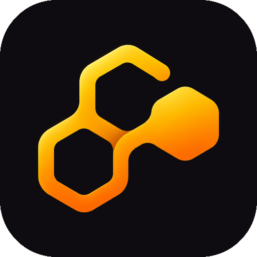
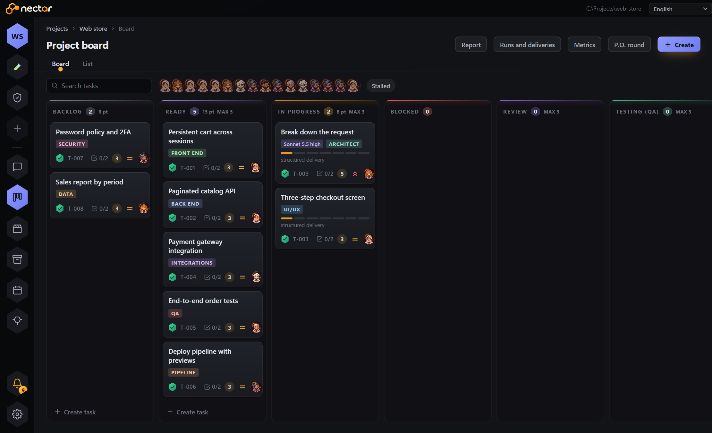
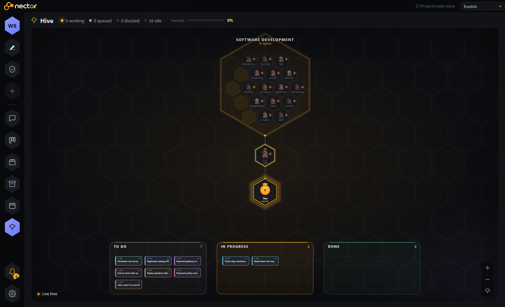
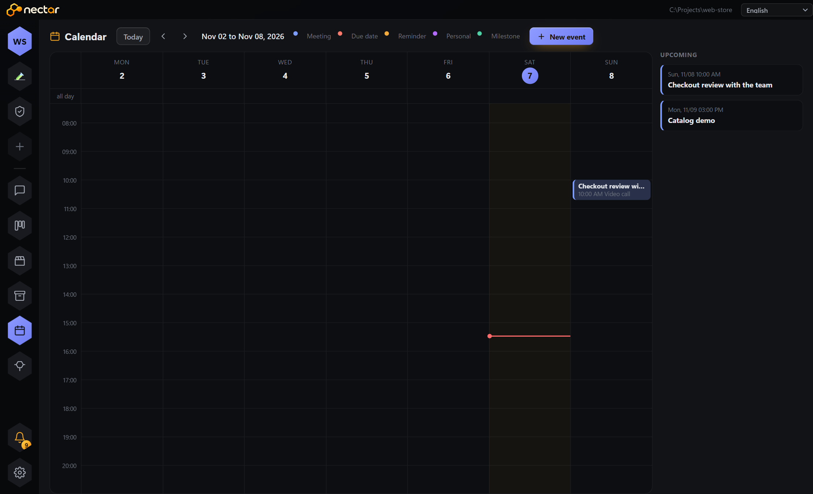

<p align="center">
  
</p>

<h1 align="center">NECTAR</h1>

<p align="center">
  <strong>A whole team of AI agents working on your project, the way a real team does.</strong><br>
  Chat, task board, memory, calendar, and a hive view that shows who is doing what.
</p>

<p align="center">
  <a href="https://github.com/deefaraujo/NECTAR/releases/latest"></a>
  
  
  <a href="LICENSE"></a>
  
</p>

<p align="center">
  <a href="#getting-started">Getting started</a> ·
  <a href="#how-it-works">How it works</a> ·
  <a href="#ready-made-teams">Ready-made teams</a> ·
  <a href="#support-the-project">Support the project</a> ·
  <a href="#license">License</a> ·
  <a href="docs/README.md">Docs</a> ·
  <a href="CHANGELOG.md">Changelog</a> ·
  <a href="#contact">Contact</a>
</p>

<p align="center">
  
</p>

---

## The idea

Most AI coding tools are a single assistant that does everything. NECTAR starts from a different premise: **large projects need roles, agreements, and a board everyone can see**.

You describe what you want in the chat. The team lead (a P.O., a Chief of Staff, or a Game Director, depending on the template) turns the request into cards, hands them to the right specialists, enforces acceptance criteria, runs them through review and QA, and comes back with a verified deliverable. Everything is recorded: who did it, with what evidence, at what cost.

Agents run through the **CLIs you already have installed** (Claude Code and Codex). NECTAR does not resell models, does not store your API keys, and does not ship your project anywhere: everything runs on your machine, with the accounts and limits you already use.

## What you get

- **A team with defined roles.** Architect, front end, back end, UI/UX, data, integrations, pipeline, security, QA, reviewer. Each one has its own instructions, skills, and limits.
- **A board the team respects.** Backlog, Ready, In progress, Blocked, Review, QA, Done. Per-column limits, mandatory acceptance criteria, dependencies between cards.
- **Autopilot with a brake.** Turn it on and the team pulls cards on its own. The agreements you wrote apply to everyone, and risky decisions come back to you.
- **Memory per project.** Rules, references, measured facts, and each agent's context are saved and enter the prompt at the right moment.
- **Cost control.** Model per task type, effort ceiling, a read of your account usage, per-card estimate, and a consumption report.
- **Local voice calls.** Talk to the team lead as in a call, with transcription and speech generated on your machine.
- **Integrations.** Jira, Notion, GitHub, and Outlook through MCP, with the connection tested before it shows as active.

## Screens

<table>
  <tr>
    <td align="center"><br><sub><b>Board</b>: columns with limits, points, the model chosen per card, and the avatar of whoever is on it</sub></td>
    <td align="center"><br><sub><b>Card</b>: acceptance criteria, facts, dependencies, review, QA, and rework</sub></td>
  </tr>
  <tr>
    <td align="center"><br><sub><b>Hive</b>: the whole team, who is working, who is waiting, and the day's harvest</sub></td>
    <td align="center"><br><sub><b>Calendar</b>: one per project; you and the agents schedule, and reminders become notifications</sub></td>
  </tr>
</table>

## Getting started

**Download:** grab `NECTAR-<version>-win-x64.zip` from the [latest release](https://github.com/deefaraujo/NECTAR/releases/latest), unzip it, and run `NECTAR.exe`.

**From source:** Windows, Node.js 22, npm, and Git. To run real agents, have [Claude Code](https://docs.claude.com/en/docs/claude-code) or the [Codex CLI](https://github.com/openai/codex) installed and logged in.

```powershell
git clone https://github.com/deefaraujo/NECTAR.git
cd NECTAR
npm ci
npm start
```

This opens the desktop app. For the web interface only, use `npm run web`.

First use:

1. Click **+** in the sidebar and point to your project folder.
2. Pick a team template (see below).
3. Write what you want in the team channel. The lead opens the cards and calls whoever does the work.
4. Follow along on the board or in the hive. Turn on **autopilot** when you want the team to keep going by itself.

The interface language can be changed in the header. Optional features (voice, visual agent, packaging) need Python and their own dependencies. See [docs/development.md](docs/development.md).

## How it works

```
you ──► team chat ──► lead ──► cards on the board ──► specialists ──► review ──► QA ──► delivery
                        ▲                                    │
                        └──── agreements, memory, facts ◄────┘
```

- **Templates** ([templates/](templates/)) describe each team: roles, personalities, skills, workflow, and rules.
- **Orchestration** ([lib/](lib/)) handles the board, calls to the CLIs, memory, credits, calendar, integrations, and autopilot.
- **Interface** ([public/](public/)) is plain HTML, CSS, and JavaScript, served by a local loopback server.
- **Desktop** ([electron/](electron/)) wraps it all in a window with context isolation.

More in [docs/architecture.md](docs/architecture.md). The full documentation index is in [docs/](docs/README.md), starting with the [user guide](docs/user-guide.md).

## Ready-made teams

| Template | What it does | Agents |
|---|---|---|
| **Software development** | Architecture, front end, UI/UX, back end, data, integrations, pipeline, security, QA, review, and versioning | 16 |
| **Product Designer** | From problem discovery to a working prototype, testing, and documentation | 41 |
| **Creative & Visual Design Studio** | Branding, art direction, editorial, illustration, motion, social, and prepress | 27 |
| **Professional Operations** | A Chief of Staff that reconstructs what you did from Git, boards, Jira, and Notion and builds reviews, reports, and presentations | 18 |
| **Game development** | 2D games in Ren'Py for mobile: script, code, touch UI, sprites, VFX, and game feel | 14 |
| **Vertical Series** | A 9:16 series studio: from the story to the animated storyboard of each scene, with a series bible | 7 |

Each template is just configuration: copy one and build your own team. See [docs/templates.md](docs/templates.md).

## Checks

```powershell
npm test               # main suite (simulated mode, no model calls)
npm run test:teamwork  # contracts, worktrees, security policy
npm run check:publication
```

Simulated tests do not prove the behavior of real models. See [docs/development.md](docs/development.md).

## Privacy

This repository contains **the tool only**. Projects, conversations, credentials, and runtime data stay out of Git, in the `data/`, `projetos/`, and `relatorios/` folders. Agents can edit files and run commands with the permissions granted to the app: use test projects and keep backups. Read [docs/privacy.md](docs/privacy.md).

## Support the project

NECTAR is built by one person, in their free time. If it helped you and you want to support development:

<p align="center">
  <a href="https://www.paypal.com/donate/?hosted_button_id=TNJJ5CSX9E5DC"></a>
</p>
<p align="center">
  <a href="https://www.paypal.com/donate/?hosted_button_id=TNJJ5CSX9E5DC"></a><br>
  <sub>or point your camera at the QR code</sub>
</p>

Donations do not grant a commercial license; they are only support for the work. Ideas, questions, and bug reports are welcome in the issues.

## License

The code is **source-available, for personal use and non-commercial study**, as set out in [LICENSE](LICENSE). Commercial, professional, or institutional use requires written authorization and a separate license. This is not an unrestricted open source license.

Third-party dependencies and fonts keep their own licenses: [THIRD_PARTY_NOTICES.md](THIRD_PARTY_NOTICES.md). Before proposing contributions, read [CONTRIBUTING.md](CONTRIBUTING.md).

## Contact

**Déborah Fernandes**

<p align="left">
  <a href="https://github.com/deefaraujo"></a>
  <a href="https://www.linkedin.com/in/d%C3%A9borah-fernandes-de-araujo-66948b191/"></a>
  <a href="https://www.instagram.com/deebscode/"></a>
  <a href="mailto:deefaraujo@gmail.com"></a>
</p>

For a commercial license, write by e-mail or through GitHub. Silence or a public repository does not count as authorization.
